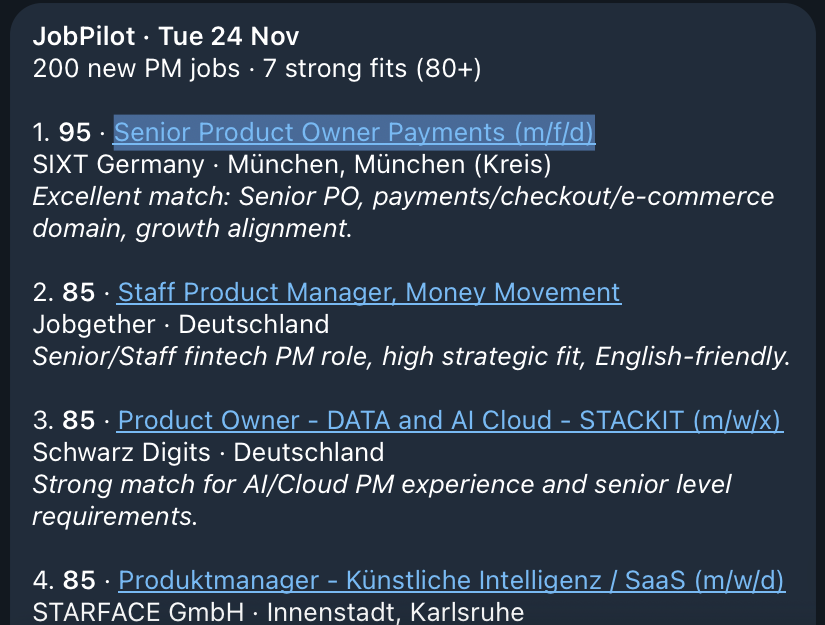
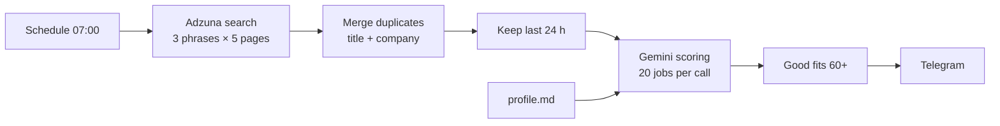

# JobPilot

> For product managers looking for a job in Germany: every morning, a Telegram message with the day's new PM jobs, scored 0–100 for fit against your CV.

**PM:** Kapil Babel · **Sprint 2** · **Cost:** €0

## The problem
Checking job boards every day takes about an hour, and good roles still get missed or found too late. Keyword alerts don't help much: "Product Manager" returns hundreds of ads a day, and most of them don't fit on seniority, domain or language.

## What it does


Every day at 07:00, JobPilot:
1. collects the last 24 hours of PM and Product Owner jobs in Germany from Adzuna,
2. asks Gemini to score each one 0–100 against a short candidate profile, with a one-line reason,
3. sends only the good fits (score 60+, at most 10) to Telegram, with a count of how many ads were in German.

## Results
First run, 24 Nov 2026:

| Metric | Target | Result |
|---|---|---|
| Reliability | Digest arrives every day | First scheduled run: 25 Nov (pending) |
| Relevance | ≥ 70% of top-5 jobs judged relevant | ❌ 1 of 5 (20%) on 24 Nov, rated by Claude against the profile, not by the user. 3 of the top 5 were German-language ads that Gemini scored 85 despite the prompt rule |
| Cost | €0 | €0: self-hosted n8n and free tiers |
| Volume | — | 485 results → 202 new unique jobs → 4 good fits sent |
| Scoring coverage | — | 200 of 202 jobs scored (2 dropped by the model) |

## Key finding
**The bottleneck wasn't the AI scoring but the language of the market.** In the first run, 3 of the top 5 jobs were German-language ads that Gemini scored 85, despite a prompt rule capping them at 50. Enforcing the cap in code fixed the ranking, and showed that 189 of 202 PM ads (94%) are written in German, often behind an English job title. For a candidate with A2 German, only about 10–15 ads a day are realistic. So the digest now shows only good fits instead of always filling 10 slots: a short list you can trust beats a long one you have to re-check.

## How it works


- **n8n in Docker** runs the whole pipeline: no app server, no code to deploy. The workflow is in [`workflows/jobpilot.json`](workflows/jobpilot.json).
- **Adzuna** returns ~485 results a day for "product manager", "produktmanager" and "product owner". About a third are the same job posted in several cities; they're merged on a normalised title + company.
- **Gemini** (`gemini-3.1-flash-lite`) scores 20 jobs per call, about 11 calls a day. The prompt has a scoring guide and caps non-PM roles at 30. German-language ads are capped at 50 in code (a stopword count), because Gemini ignored that rule in the prompt.
- **The candidate profile** is a short Markdown file kept out of the repo. Only an empty template, [`profile.example.md`](profile.example.md), is public.

## Key product decisions
- [ADR-001: Adzuna instead of the Bundesagentur API](docs/decisions/ADR-001-job-source.md): the official API throttled the per-job detail calls; Adzuna gives 2.5× the volume in ~15 calls a day. LinkedIn scraping was ruled out because it breaks LinkedIn's terms.
- [ADR-002: A 24-hour window instead of a "seen before" memory](docs/decisions/ADR-002-new-job-window.md): stateless and simple, at the cost of missing late listings or a skipped day.

## Limitations & what's next
- **Short descriptions:** Adzuna cuts descriptions to ~500 characters, so Gemini judges seniority and domain from a teaser.
- **German detection is a heuristic:** a stopword count, so a mixed-language ad can be misclassified. The cap is one constant (`GERMAN_MAX`) to raise as the candidate's German improves.
- **Runs on a laptop:** if the Mac is asleep at 07:00, that day's digest is skipped and its jobs are lost (ADR-002).
- **No message on an empty day:** if no new jobs come in, nothing is sent, which looks like a failure.
- **Next (issue #8):** more sources (LinkedIn job-alert emails, Arbeitnow) and feedback buttons in Telegram to collect relevance ratings automatically.

## Built with
n8n (self-hosted, Docker) · Adzuna Jobs API (free tier) · Gemini API, `gemini-3.1-flash-lite` (free tier) · Telegram Bot API

## Run locally
Needs Docker, plus free keys from [Adzuna](https://developer.adzuna.com), [Google AI Studio](https://aistudio.google.com) and a Telegram bot from @BotFather.

```bash
cp profile.example.md profile.md   # describe the candidate
docker volume create n8n_data
docker compose up -d               # n8n on http://localhost:5678
docker cp workflows/jobpilot.json n8n:/tmp/jobpilot.json
docker exec n8n n8n import:workflow --input=/tmp/jobpilot.json
```

Then in n8n, create three credentials and select them in the matching nodes:
- **Adzuna** (Custom Auth): `{"qs": {"app_id": "…", "app_key": "…"}}`
- **Gemini** (Header Auth): name `x-goog-api-key`, value your key
- **Telegram**: your bot token

Finally, set your chat ID in the *Send to Telegram* node and publish the workflow.
